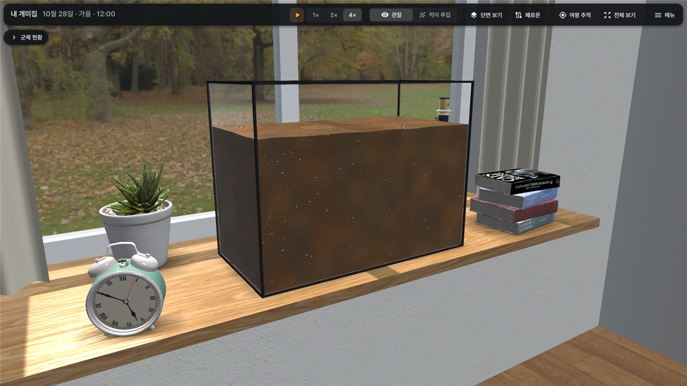
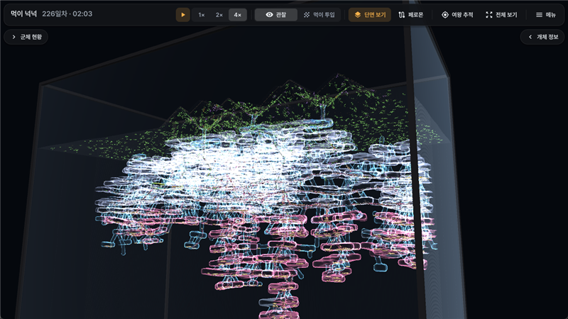
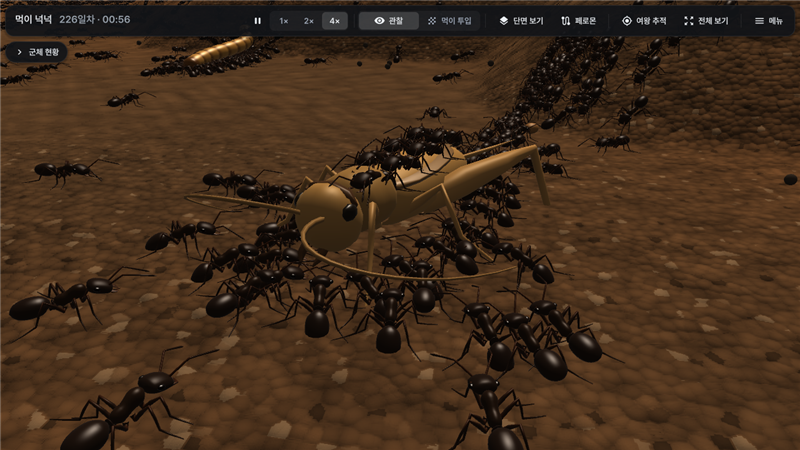
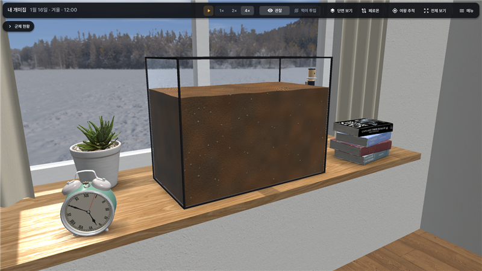
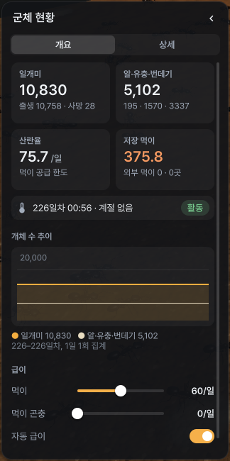

# 개미 수조

개미 연구 문헌을 근거로 만든 3D 개미 수조 시뮬레이션입니다.

- 흙을 채운 유리 수조에 여왕과 일개미를 넣으면 일개미가 스스로 둥지를 굴착합니다.
- 먹이를 찾아 동료를 동원하고, 큰 곤충을 함께 포획합니다.
- 지온에 따라 휴면합니다.
- 수조는 남향 창의 창턱에 놓여 있어 창밖으로 하루와 계절이 지나갑니다.

**[웹에서 실행](https://dhsrua555.github.io/ant-farm/)** · **[내려받기 (Windows · Android)](https://github.com/dhsrua555/ant-farm/releases/latest)** · **[업데이트 기록](CHANGELOG.md)**

## 주요 기능

<table>
<tr>
<td width="50%"> <b>굴착</b>: 개미가 스스로 판 굴과 방입니다. [단면 보기]를 켜면 흙 속 구조가 보이며, 방은 쓰임새(여왕방·유충방·저장방 등)에 따라 색이 다릅니다.</td>
<td width="50%"> <b>포식</b>: 여러 개체가 다리를 붙잡고 물어 큰 곤충을 제압합니다. 곤충이 죽으면 해체해 둥지로 운반합니다.</td>
</tr>
<tr>
<td> <b>계절</b>: 창밖 풍경은 실제 사진이며 계절에 따라 바뀝니다. 지온이 떨어지면 개미는 깊은 방에 모여 휴면합니다.</td>
<td><b>군체 현황</b>: [개요] 탭에는 일개미·알·유충·번데기 수, 산란율과 제한 요인, 저장 먹이, 지온과 활동 상태, 개체 수 추이, 급이 설정이 있습니다. 나머지 수치는 [상세] 탭에 있습니다.</td>
</tr>
</table>

### 모형 종
- **흑개미** (*Lasius niger*)
  - 얕은 흙에 굴과 방이 미로처럼 얽힌 둥지를 짓습니다.
  - 먹이를 발견하면 길잡이 페로몬으로 동료를 동원합니다.
  - 큰턱으로 물고 포름산을 분사합니다.
- **플로리다 수확개미** (*Pogonomyrmex badius*)
  - 나선 통로를 2–3 m까지 굴착하며 납작한 방을 층층이 만듭니다.
  - 흩어진 풀씨를 개체마다 하나씩 채집해 저장합니다.
  - 체격이 크고 외골격이 두껍습니다.
- **왕침개미** (*Brachyponera chinensis*)
  - 단독으로 순찰하며 흰개미를 독침으로 마비시켜 포획합니다.
  - 큰 먹이를 발견하면 둥지의 동료를 물어 운반합니다(운반 동원).
  - 여왕이 여럿으로 늘어납니다.

### 개미의 행동
- **굴착**: 육각 칸 단위로 굴착합니다. 군체가 클수록 둥지가 넓고 깊어지며, 방의 밀도가 높아지면 더 굴착합니다.
- **분업**: 육아·굴착·채집·운반·청소·예비 개미가 있습니다. 연령과 작업량에 따라 역할이 정해지고(반응 역치), 부족한 업무가 생기면 휴식 중인 개체가 그 업무로 전환합니다.
- **채집**: 정찰 개미가 먹이를 발견하면 위치를 기억하고, 길잡이 페로몬과 둥지 안 신호로 동료를 동원합니다.
- **포식**: 살아 있는 귀뚜라미·밀웜·흰개미를 포획합니다. 곤충도 차고, 물고, 다리를 자절하고 달아나며 저항합니다.
- **단백질**: 곤충 조직을 섭취한 유충은 체격이 크고 전투력이 높은 일개미가 됩니다.
- **계절**: 지온은 종의 서식지 관측 평년값을 따릅니다. 지온에 따라 보행 속도, 채집, 산란, 발육 속도가 변하고, 지온이 떨어지면 깊은 방에 모여 휴면합니다. 산란이 적을 때는 군체 현황 창에 제한 요인이 표시됩니다.

### 수조와 화면
- **수조**: 크기(가로 150 · 높이 200 · 앞뒤 200 cm까지), 흙 양과 지형(평탄·비탈·둔덕·직접 붓기), 초기 군체(일개미 5,000마리까지), 일일 먹이·곤충 공급량을 정합니다.
- **방과 창밖**: 실사 질감의 창턱·벽·마루·커튼과 창턱 소품을 갖춘 방입니다. 창밖은 계절별 실제 풍경 사진 위에 날짜·시각에 맞춰 하늘과 해가 그려집니다. 창으로 드는 햇빛은 창살 그림자와 함께 창턱과 흙 위에 비칩니다.
- **보기**: [단면 보기]로 흙 속 굴과 개체를, [페로몬]으로 길잡이 페로몬과 발자국 신호를 표시합니다. 개체를 선택하면 추적합니다.
- **저장**: 개미집을 파일로 저장하고 불러옵니다. 배속은 1×·2×·4×입니다.

## 설치와 실행

| 환경 | 방법 |
|---|---|
| 웹 브라우저 | https://dhsrua555.github.io/ant-farm/ 을 엽니다. PC와 휴대폰·태블릿에서 모두 실행됩니다(휴대폰은 가로 화면). |
| Windows | [Releases](https://github.com/dhsrua555/ant-farm/releases/latest)에서 `AntFarm-v…-Windows.zip`을 받아 압축을 풀고 `AntFarm/AntFarm.exe`를 실행합니다. |
| Android | [Releases](https://github.com/dhsrua555/ant-farm/releases/latest)에서 `AntFarm-v…-Android.apk`를 휴대폰에서 받아 설치합니다. 처음에는 "출처를 알 수 없는 앱" 설치를 허용해야 합니다. 이전 판 위에 덮어 설치됩니다. |

웹판에서 저장한 개미집은 해당 브라우저 안에만 남습니다.

## 조작

**PC**
| 조작 | 기능 |
|---|---|
| 왼쪽 드래그 | 궤도 회전 |
| 오른쪽 드래그 | 시점 이동 |
| 휠 | 확대·축소 |
| 더블클릭 | 해당 지점으로 이동 |
| 개체·곤충 클릭 | 선택·추적 |
| Space · X · F · P · H · Z · C · 1–3 | 일시정지 · 단면 보기 · 먹이 투입 · 페로몬 · 정보 창 · 여왕 추적 · 전체 보기 · 배속 |

**휴대폰·태블릿**
| 조작 | 기능 |
|---|---|
| 한 손가락 끌기 | 시점 이동 |
| 두 손가락 끌기 | 궤도 회전(좌우: 방위, 위아래: 기울기) |
| 두 손가락 벌리기·좁히기 | 확대·축소 |
| 두 손가락 비틀기 | 수직축 회전 |
| 밀어서 놓기 | 관성 이동·회전 |
| 두 번 탭 | 해당 지점으로 이동 |
| 개체 탭 | 선택·추적 |

두 손가락 조작은 모드 구분 없이 동시에 적용됩니다. 게임 안 [메뉴] → [조작 안내]에 자세한 설명이 있습니다.

## 근거 문헌

개미의 행동과 수치는 가능한 한 문헌에서 가져왔습니다. 대표적인 출처는 다음과 같습니다.
- 흑개미 굴착: García Ibarra 외 2024, Khuong 외 2016
- 길잡이 페로몬과 동원: Beckers 외 1993, Mailleux 외 2010·2011, Czaczkes 외 2011·2013
- 수확개미 둥지 주형과 분업: Tschinkel 2004·2017, Kwapich & Tschinkel 2013
- 왕침개미 운반 동원과 포식: Guénard & Silverman 2011, Bednar & Silverman 2011
- 계절과 온도: Kamitani 외 2015, Kuroki 2019, Kwapich & Tschinkel 2013, Zungoli & Benson 2008, Kipyatkov 외 2004, Penick 외 2017, 기상청 지중온도 평년값

자료가 없어 정한 값은 추정값 또는 가정으로 표시했습니다. 출처와 각 값의 적용 방식은 게임 안 **[참고 문헌]** 창에 정리되어 있습니다.

## 판 번호

판 번호는 `v주.부.수` 형식이며 새 개미집 창 제목 옆에 표시됩니다. 판마다 바뀐 내용은 [업데이트 기록](CHANGELOG.md)과 [Releases](https://github.com/dhsrua555/ant-farm/releases)에 있습니다. 이전 판에서 저장한 개미집도 새 판에서 열립니다.

## 이 저장소

이 저장소에는 웹판 빌드 파일(GitHub Pages), 이 문서, 업데이트 기록만 있습니다. Windows·Android 설치 파일은 Releases에 올립니다. Unity 6으로 만들었습니다.

### 사용한 자원
- 글꼴: [Pretendard](https://github.com/orioncactus/pretendard)(SIL Open Font License 1.1)
- 아이콘: [Material Icons](https://github.com/google/material-design-icons)(Apache License 2.0)
- 3D 에셋(CC0, [Poly Haven](https://polyhaven.com)). Blender로 재질을 텍스처 한 장으로 굽고, 다각형 수를 줄이고, 접촉 그림자를 만들고, 하늘을 오려 냈습니다.
  - 질감: white_stucco, oak_veneer_01, wood_floor, white_maple_veneer, rough_linen
  - 모델: potted_plant_04, ceramic_vase_04, alarm_clock_01, vintage_microscope, decorative_book_set_01, stationery_supplies
  - 창밖 사진(HDRI): evening_meadow, noon_grass, tiergarten, near_the_river_01, passendorf_snow, tree_lined_driveway, missile_launch_facility_02
